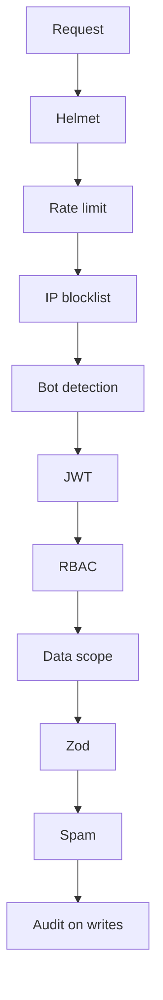
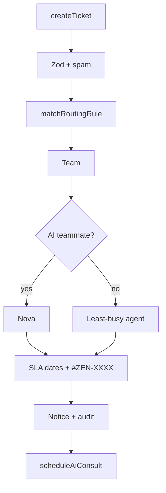

# ZenFlowAI — plan (as shipped)

Local service-desk demo. **Phases 1–9 are complete.** There is no cloud host, email SaaS, or paid LLM in this repository.

This file is the architecture snapshot. Journey, data, and algorithm charts for each slice live in **[docs/phases](docs/phases/README.md)**. The colorful one-page gallery is **[docs/phases/index.html](docs/phases/index.html)** (also [http://localhost:3000/qa/phases](http://localhost:3000/qa/phases)). Test bars: **[docs/test-results/v1](docs/test-results/v1/index.html)**.

---

## 1. Product

**Why this exists.** A small IT or customer desk needs one place to file work, talk on a thread, and measure promises. Spreadsheets lose the clock. A paid Zendesk clone is out of scope for a laptop demo. ZenFlowAI is that desk: tickets `#ZEN-XXXX`, Nova first-response from owned Help Center markdown, humans when confidence is low.

**What shipped.** Live workspace, SLA, CSAT, Help Center, per-user Appearance, analytics, local attachments, in-app notices.

**Out of scope.** Email, S3/R2, Firecrawl, paid OpenAI, webhooks, SSO, hosted CI database.

---

## 2. Roles

**Why this exists.** Support work is not one permission. A customer must not see other people’s tickets. An agent must not edit users. The ladder is fixed so later phases cannot invent a sixth role.

```
CUSTOMER → AGENT → SUPERVISOR → ADMIN → SUPER_ADMIN
```

| Who | Home after login | Typical work |
|-----|------------------|--------------|
| Customer | `/dashboard` | File and follow own tickets, Help Center |
| Agent | `/queue` | Reply, internal notes, handoff from Nova |
| Supervisor | `/supervisor` | Watch, analytics, routing |
| Admin | `/admin/users` | Users, teams, SLA, consultants, knowledge |
| Super Admin | `/admin/users` | Same ladder top as Admin in this demo |

Homes are `ROLE_HOME` in `apps/frontend/src/lib/constants.ts`.

---

## 3. Security

**Why this exists.** Ticket text is private. Checks run in one order so a new resolver cannot “just insert” a row. The JWT may carry a role; the database row is what the API uses (8-second cache per access token).



**Auth details.** Access JWT **15m** in `localStorage`. Refresh **7d** hashed in MySQL, cookie `zenflow_refresh` (HttpOnly, Path=/, SameSite=Lax; Secure only if `NODE_ENV=production`). Extra HTTP middleware (HPP, slow-down) sits with Helmet in `httpSecurity.ts`.

Full card: [docs/phases/01-auth.md](docs/phases/01-auth.md).

---

## 4. How a ticket moves

**Why this exists.** Staff need a number, a team, and a clock before anyone types a reply. Routing prefers a keyword rule, then category, then priority, then fallback. If the team has an AI member, Nova is assigned first.



**Always true.** Resolvers: auth + `requirePermission` + service. Prisma only inside `services/`. Ticket format `#ZEN-XXXX` (minimum four digits).

Full cards: [02 tickets](docs/phases/02-tickets.md) · [03 workspace](docs/phases/03-workspace.md) · [07 Nova](docs/phases/07-nova.md).

---

## 5. Screens (as coded)

**Why this exists.** Old notes said `/help`. The running app uses `/knowledge`. This table matches `nav.ts` and `app/` routes.

| Path | Who |
|------|-----|
| `/login` `/register` | Public |
| `/dashboard` `/tickets` `/tickets/new` `/tickets/[id]` `/knowledge` | Customer+ |
| `/queue` | Agent+ |
| `/knowledge/internal` | Staff |
| `/supervisor` `/admin/routing` | Supervisor+ |
| `/analytics` | Supervisor+ |
| `/admin/users` `/admin/teams` `/admin/sla` `/admin/knowledge` `/admin/consultants` `/admin/security` | Admin+ |
| `/settings` | Signed-in |
| `/qa` `/qa/v1` `/qa/phases` | Static reports (no login) |

Bell: `Notification` rows on create / assign / reply / SLA. Files: `UPLOAD_DIR` via `uploadTicketAttachment`.

---

## 6. Nova

**Why this exists.** First response should use articles the team already wrote. Nova retrieves `apps/backend/kb/`. If local Ollama is healthy it writes a grounded answer; otherwise it extracts. Confidence below **0.45**, or zero hits, or “Still need a person” → human. Drafts from a ticket are **internal and unpublished** until an admin publishes.

Full card: [docs/phases/07-nova.md](docs/phases/07-nova.md).

---

## 7. Tests and CI

**Why this exists.** GitHub Actions has no MySQL. The unit pack tests pure logic (routing, SLA, spam, RBAC, cookies, packs, journeys). Prisma services and Next pages stay out of that LCOV on purpose. Live `pnpm test:e2e` covers those I/O trees when the API is up.

- `pnpm test` — 140 Prisma-free units, **100% lines** on that pack (c8).
- `pnpm test:e2e` — customer pack + admin SLA/consultants; skips if API down.
- HTML bars: [docs/test-results/v1](docs/test-results/v1/index.html).

CI: `pnpm db:generate` + tests. **No** `migrate deploy` in GitHub Actions. Optional Sonar when `SONAR_TOKEN` is set.

Old `db push` databases: `prisma migrate resolve --applied 20260922150000_init` once.

---

## 8. Environment (names that exist)

**Why this exists.** Only these names are read. Copy `apps/backend/.env.example` and `apps/frontend/.env.local.example`. Demo users stay `*@zenflowai.com` / `password123`.

| Name | Role |
|------|------|
| `DATABASE_URL` | MySQL |
| `JWT_SECRET` / `JWT_REFRESH_SECRET` / `JWT_ACCESS_EXPIRES` | Auth (`15m` typical) |
| `PORT` `NODE_ENV` `ALLOWED_ORIGINS` | API + CORS (`credentials: true`) |
| `UPLOAD_DIR` `MAX_FILE_SIZE_MB` | Local files |
| `AI_PROVIDER` `OLLAMA_BASE_URL` `OLLAMA_MODEL` | Optional local model |
| `NEXT_PUBLIC_GRAPHQL_URL` `NEXT_PUBLIC_GRAPHQL_WS_URL` | Frontend |
| `DISABLE_CRON` `SLA_CHECK_INTERVAL_CRON` | SLA job |

---

## 9. Layout and modules

**Why this exists.** One feature folder cannot import another feature’s internals. That keeps Phase 9 UI work from rewriting ticket math.

```
apps/frontend/src/{app,modules,components,lib,store}
apps/backend/src/{graphql,services,security,jobs,utils}  prisma/  kb/
```

Shared UI → `components/ui/`. Queries → `modules/*/queries/`. Zustand = auth only; everything else is Apollo cache.

---

## 10. Phase index

**Why this exists.** The phase list used to live only as a short table here and then disappeared from the README. Each phase now has its own file plus one HTML gallery.

| Phase | Title | On `main` | Charts |
|------:|-------|-----------|--------|
| 1 | Auth, RBAC, 10 layers | yes | [md](docs/phases/01-auth.md) · [html](docs/phases/index.html#p1) |
| 2 | Tickets, routing, KB | [#1](https://github.com/iamfaizalmunna/zenflowai/pull/1) | [md](docs/phases/02-tickets.md) · [html](docs/phases/index.html#p2) |
| 3 | Workspace, graphql-ws | yes | [md](docs/phases/03-workspace.md) · [html](docs/phases/index.html#p3) |
| 4 | SLA cron, CSAT, admin | yes | [md](docs/phases/04-sla-csat.md) · [html](docs/phases/index.html#p4) |
| 5 | Appearance, views | [#3](https://github.com/iamfaizalmunna/zenflowai/pull/3) | [md](docs/phases/05-appearance.md) · [html](docs/phases/index.html#p5) |
| 6 | Analytics, consultants | [#2](https://github.com/iamfaizalmunna/zenflowai/pull/2) | [md](docs/phases/06-analytics.md) · [html](docs/phases/index.html#p6) |
| 7 | Nova | [#5](https://github.com/iamfaizalmunna/zenflowai/pull/5) | [md](docs/phases/07-nova.md) · [html](docs/phases/index.html#p7) |
| 8 | Cookie, migrations, files, bell | [#8](https://github.com/iamfaizalmunna/zenflowai/pull/8) | [md](docs/phases/08-hardening.md) · [html](docs/phases/index.html#p8) |
| 9 | UI polish, speed, QA | [#10](https://github.com/iamfaizalmunna/zenflowai/pull/10) | [md](docs/phases/09-ui-qa.md) · [html](docs/phases/index.html#p9) |

CI / Sonar: [#6](https://github.com/iamfaizalmunna/zenflowai/pull/6).

---

## 11. Phase 9 notes (speed)

**Why this exists.** Admin tabs lagged because Next compiled each client page on demand, then auth hit MySQL twice. The SLA form was not the bottleneck.

- Turbopack in `pnpm dev`; production `next build` unchanged.
- `loading.tsx` skeletons on admin, agent, customer, settings.
- JWT still verified every request; user + permission rows cached **8s**.
- Consultant list **90 days**, profile **112 days**.
- Help Center home search is the **40-article** pack in the browser. Create-ticket related articles still query GraphQL after 4 characters.

Not in Phase 9: new roles, email, hosting.
