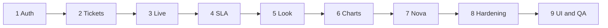

<p align="center">
  
</p>

<h1 align="center">ZenFlowAI</h1>

<p align="center">
  Local service-desk demo. Customers file <code>#ZEN-XXXX</code>.
  Nova answers first from the owned Help Center (optional local Ollama).
  A person takes over when confidence is low.
</p>

<p align="center">
  <strong>Phases 1–9 are complete.</strong>
  No cloud host, no email SaaS, no paid LLM.
</p>

<p align="center">
  <a href="#run-in-cursor-agent"></a>
  <a href="#run-in-cursor-agent"></a>
  <a href="docs/phases/README.md"></a>
  <a href="http://localhost:3000/qa/v1/"></a>
  <a href="LICENSE"></a>
</p>

<p align="center">
  
  
  
  
  
  
  
  
  
  
  
  <br>
  
  
  
  
  
  
  
  <br>
  
  
  
  
  
</p>

## Completed phases

Nine slices, in order. Full journey / data / algorithm charts: **[docs/phases](docs/phases/README.md)** (Markdown) and **[docs/phases/index.html](docs/phases/index.html)** (color gallery — also [http://localhost:3000/qa/phases](http://localhost:3000/qa/phases)).

<table>
  <tr>
    <td align="center" width="11%"><a href="docs/phases/01-auth.md"></a><br><sub>JWT, RBAC, 10 checks</sub></td>
    <td align="center" width="11%"><a href="docs/phases/02-tickets.md"></a><br><sub>#ZEN-XXXX, routing</sub></td>
    <td align="center" width="11%"><a href="docs/phases/03-workspace.md"></a><br><sub>graphql-ws desk</sub></td>
    <td align="center" width="11%"><a href="docs/phases/04-sla-csat.md"></a><br><sub>cron, CSAT, admin</sub></td>
    <td align="center" width="11%"><a href="docs/phases/05-appearance.md"></a><br><sub>per-user theme</sub></td>
    <td align="center" width="11%"><a href="docs/phases/06-analytics.md"></a><br><sub>analytics, pack</sub></td>
    <td align="center" width="11%"><a href="docs/phases/07-nova.md"></a><br><sub>owned KB, Ollama</sub></td>
    <td align="center" width="11%"><a href="docs/phases/08-hardening.md"></a><br><sub>cookie, files, bell</sub></td>
    <td align="center" width="11%"><a href="docs/phases/09-ui-qa.md"></a><br><sub>speed, 140 tests</sub></td>
  </tr>
</table>



Roles: `CUSTOMER → AGENT → SUPERVISOR → ADMIN → SUPER_ADMIN`. Architecture notes: [`PLAN.md`](PLAN.md). Test bars: [`/qa/v1`](http://localhost:3000/qa/v1/).

## Run in Cursor (Agent)

Open this repository in **Cursor**. Required on the machine: **Node 20+**, **pnpm 9+**, **MySQL** (demo often port **3307**). The Agent can copy env files, migrate, run tests, and start both servers.

**Paste this into Agent chat**

```text
Run ZenFlowAI for local testing.

1. Copy env files if missing:
   apps/backend/.env.example → apps/backend/.env
   apps/frontend/.env.local.example → apps/frontend/.env.local
2. In apps/backend/.env set DATABASE_URL to my local MySQL (often mysql://root@localhost:3307/zenflowai).
3. pnpm install
4. pnpm db:generate && pnpm db:migrate && pnpm db:seed
   If migrate fails on an old demo DB: prisma migrate resolve --applied 20260922150000_init then migrate again.
5. pnpm test && pnpm test:e2e
   Open docs/test-results/v1/index.html for the versioned results sheet.
6. pnpm dev
7. Tell me when the UI is up at http://localhost:3000 and GraphQL at http://localhost:4000/graphql.
```

**When the process finishes**

| | Open |
|---|---|
| App UI | [http://localhost:3000](http://localhost:3000) |
| Phase charts | [http://localhost:3000/qa/phases](http://localhost:3000/qa/phases) · [docs/phases](docs/phases/README.md) |
| Test report v1 | [http://localhost:3000/qa/v1/](http://localhost:3000/qa/v1/) · [docs/test-results](docs/test-results/README.md) |
| GraphQL | [http://localhost:4000/graphql](http://localhost:4000/graphql) |
| Login | `customer@zenflowai.com` / `password123` — every demo user uses that password |

If MySQL is not running, start it first, then send the same prompt again. Manual steps: [Quick start](#quick-start).

## Why this stack

Each badge above is in the running product. Next.js 15 (Turbopack in `pnpm dev`) paints the desk. Apollo talks GraphQL to Express so the UI and a future script share one contract. Prisma + MySQL keep tickets and sessions on one machine. JWT + an HttpOnly cookie cover short access and a 7-day refresh without putting the refresh token in JavaScript storage. Zod validates input before Prisma. Optional Ollama stays on localhost; the Help Center still answers if the model is down. pnpm workspaces + GitHub Actions run the Prisma-free unit pack. SonarQube is optional when `SONAR_TOKEN` is set.

Security order: Helmet → rate limit → IP blocklist → bot detection → JWT → RBAC → data scope → Zod → spam → audit.

## Quick start

Need Node ≥ 20, pnpm ≥ 9, MySQL (demo often `localhost:3307`).

```bash
git clone https://github.com/iamfaizalmunna/zenflowai.git
cd zenflowai
pnpm install
cp apps/backend/.env.example apps/backend/.env          # set DATABASE_URL
cp apps/frontend/.env.local.example apps/frontend/.env.local
pnpm db:generate && pnpm db:migrate && pnpm db:seed
pnpm dev   # http://localhost:3000  ·  GraphQL http://localhost:4000/graphql
```

Already-pushed demo DBs (old `db push`): run once  
`pnpm --filter backend exec prisma migrate resolve --applied 20260922150000_init`

CI (`.github/workflows/test.yml`) only runs `pnpm db:generate` + unit tests. No hosted MySQL.

## Demo logins

Password for all: `password123`

| Role | Email |
|------|-------|
| Super Admin | superadmin@zenflowai.com |
| Admin | admin@zenflowai.com |
| Supervisor | supervisor@zenflowai.com |
| Agent | agent@zenflowai.com, jordan@…, priya@…, marcus@…, lina@… |
| AI (Nova) | nova@zenflowai.com |
| Customer | customer@zenflowai.com |

Appearance (`/settings`) is per signed-in user. Login and register stay on the default light theme.

## What the demo includes

| Area | In the product |
|------|----------------|
| Tickets | Create, queue, 3-column workspace, live thread |
| Nova | First assignee when on the team; owned KB; optional Ollama; handoff |
| Ops | SLA cron, CSAT, admin users/teams/routing/SLA/KB drafts |
| UI | Per-user Appearance, PWA chrome ≤1024px |
| Speed | Turbopack, skeletons, 90-day consultant packs, client list search |
| Analytics | `/analytics` (Supervisor+); consultants (Admin+) |

Not in this demo: email, S3/R2, Firecrawl, paid OpenAI, webhooks, SSO, hosting.

KB markdown: `apps/backend/kb/`. `pnpm --filter backend ai:doctor` prints retrieval vs Ollama.

## Layout

```
apps/backend/   prisma/  kb/  src/{graphql,services,security,jobs,utils}
apps/frontend/  src/{app,modules,components,lib,store}
PLAN.md         architecture snapshot
docs/phases/    one file per phase + HTML gallery
docs/test-results/  HTML test bars
```

Resolvers stay thin (auth + permission + service). Prisma stays in `services/`.

## GraphQL (common)

One API for the UI and scripts. Refresh uses the cookie, not a JSON refresh token.

```graphql
mutation { login(email: "...", password: "...") { accessToken user { id role } } }
mutation { refreshToken { accessToken } }
query { me { id role } myNotifications { id title ticketId isRead } }
mutation { createTicket(input: { title, description, type: QUESTION }) { ticketNumber } }
mutation { uploadTicketAttachment(ticketId: 1, filename: "a.png", mimeType: "image/png", contentBase64: "...") { id } }
subscription { messageAdded(ticketId: 1) { id body } }
```

## How admin tabs stay fast

Lag was on-demand compile of each `'use client'` page, then GraphQL auth hitting MySQL twice — not the SLA form itself.

| Layer | Change | Side effect |
|-------|--------|-------------|
| Dev compile | `next dev --turbopack` | Production `next build` unchanged |
| First paint | `loading.tsx` skeletons | Sidebar stays mounted |
| Tab change | CSS `animate-route-in` on the page slot | Reduced-motion still disables it |
| Auth | JWT verified every time; user + permissions cached **8s** | Ban / role change can lag 8s |
| Consultants | Assigned tickets **90 days** (profile **112**) | KPIs are the pack, not lifetime |
| Lists | `filterByQuery` on the loaded pack | `admin` also matches `SUPER_ADMIN` |
| Help Center | Browser filter of the **40-article** pack | Create-ticket search still hits GraphQL after 4 characters |

Unchanged on purpose: role ladder, `#ZEN-XXXX`, resolver → service → Prisma, cookies, SLA math, queue subscriptions, Nova handoff.

```bash
pnpm test          # 140 Prisma-free units + journeys (100% c8 lines on that pack)
pnpm test:e2e      # live GraphQL when the API is up
pnpm test:report   # docs/test-results/v1/index.html
```
