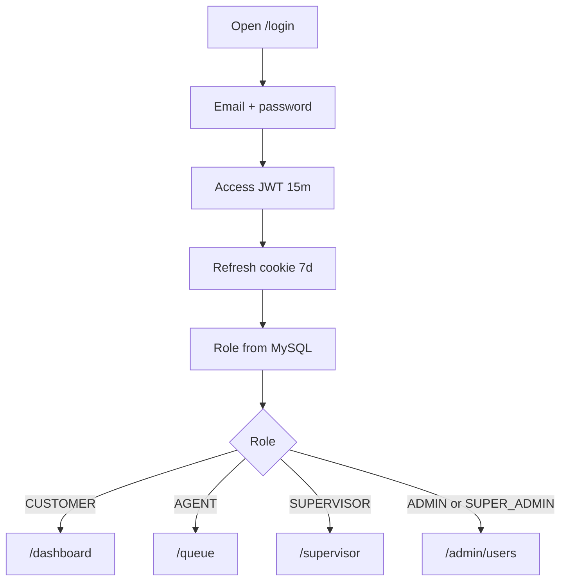
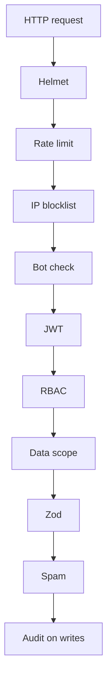

# Phase 1 — Auth and security

**Status:** complete on `main`.  
**Who it is for:** every person who opens the demo — customer through super admin.  
**What it unlocks:** a signed-in session, a role, and a home screen. No tickets exist until this works.

## Intro

This is the front door. ZenFlowAI is a support desk, so ticket text is private. Phase 1 does not create tickets. It answers three questions on every request: is this person signed in, which role are they, and may they open this screen?

Roles are a ladder that never reverses: Customer → Agent → Supervisor → Admin → Super Admin. A customer can file their own tickets. They cannot open `/admin/users`. An agent can work a queue. They cannot ban accounts. Later phases reuse this ladder; they do not invent a sixth role.

## Why this phase exists

Without a locked door, every later screen is a leak. Security checks run in a **fixed order** so a new GraphQL resolver cannot skip the queue and “just insert a row”. The JWT may carry a role for convenience. The **MySQL user row** is what the API trusts. That row is cached for **8 seconds** on the same access token so admin tabs do not hit the database twice on every click.

## What you see

| Person | After login they land on |
|--------|--------------------------|
| Customer | `/dashboard` |
| Agent | `/queue` |
| Supervisor | `/supervisor` |
| Admin or Super Admin | `/admin/users` |

Login is `/login`. Register is `/register`. Forgot password exists as a screen; this demo does not send email. Password for seeded users is `password123`.

## How a session works

1. The person submits email and password.
2. The API returns a **15-minute** access JWT (kept in `localStorage` for Apollo).
3. A **7-day** refresh token is stored as cookie `zenflow_refresh` (HttpOnly, SameSite=Lax, `Secure` only in production).
4. Each GraphQL call sends the JWT. The API verifies it, then loads `userId`, `role`, and permission overrides from MySQL (or the 8-second cache).
5. `requirePermission` runs on protected resolvers. Customers only see their own tickets (data scope).
6. When the access JWT expires, `refreshToken` reads the cookie and issues a new 15-minute JWT. The browser retries the failed call.

## Request checks (order)

| Step | Check | Plain meaning |
|-----:|-------|----------------|
| 1 | Helmet | Safe HTTP headers |
| 2 | Rate limit | Slow down a noisy IP |
| 3 | IP blocklist | Known bad addresses stop here |
| 4 | Bot check | Obvious bots off non-API paths |
| 5 | JWT | Must be signed in |
| 6 | RBAC | Role must allow this action |
| 7 | Data scope | Customer sees only own rows |
| 8 | Zod | Body must match the schema |
| 9 | Spam | Ticket text is scored |
| 10 | Audit | Sensitive writes are logged |

## Examples

- A customer opens `/tickets`. Allowed. The same customer opens `/admin/users`. Blocked.
- An admin bans an account. Within about 8 seconds the next request from that token fails.
- Access JWT dies after 15 minutes. The cookie silently refreshes it. The person is not sent back to login unless the 7-day cookie is gone.

## Not in this phase

Tickets, Nova, SLA, and Appearance. Email verify, SSO, and 2FA were in an early wish list and are **not** in the demo.

## Code

`apps/backend/src/security/` · `apps/backend/src/middleware/auth.ts` · `apps/frontend/src/lib/constants.ts` · `apps/frontend/src/app/(auth)/login`

[All phases](README.md) · [HTML gallery](index.html#p1)
