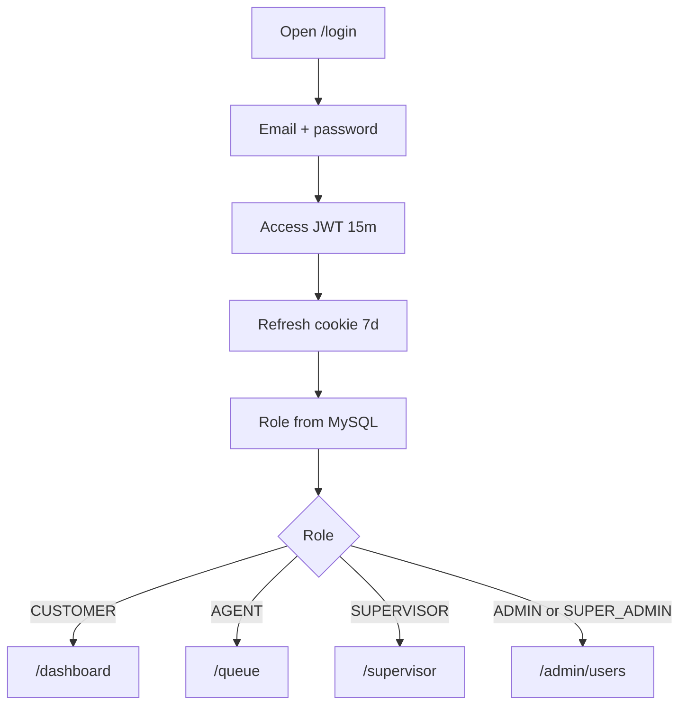
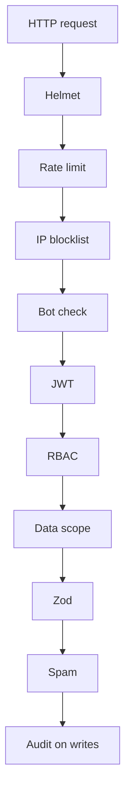

# Phase 1 — Auth and security

**Status:** complete on `main`.

## Why this phase exists

A support desk stores private messages. Before tickets exist, the product must know who is signed in and what that person may open. Roles are a ladder that never reverses. Security checks run in a fixed order so a later screen cannot skip the queue.

## What was delivered

- Access JWT lasts **15 minutes**. Refresh token lasts **7 days** in cookie `zenflow_refresh` (HttpOnly, SameSite=Lax).
- Role on the JWT is not trusted. The API reads the user row (identity cache **8 seconds** for the same token).
- Home screens: customer `/dashboard`, agent `/queue`, supervisor `/supervisor`, admin `/admin/users`.

## User journey

## Request algorithm

## Use cases

- A customer reaches tickets, not `/admin/users`.
- After a ban, the next request fails once the 8-second cache expires.

## Code

`apps/backend/src/security/` · `apps/frontend/src/lib/constants.ts` · `apps/frontend/src/app/(auth)/login`

[All phases](README.md) · [HTML card](index.html#p1)
