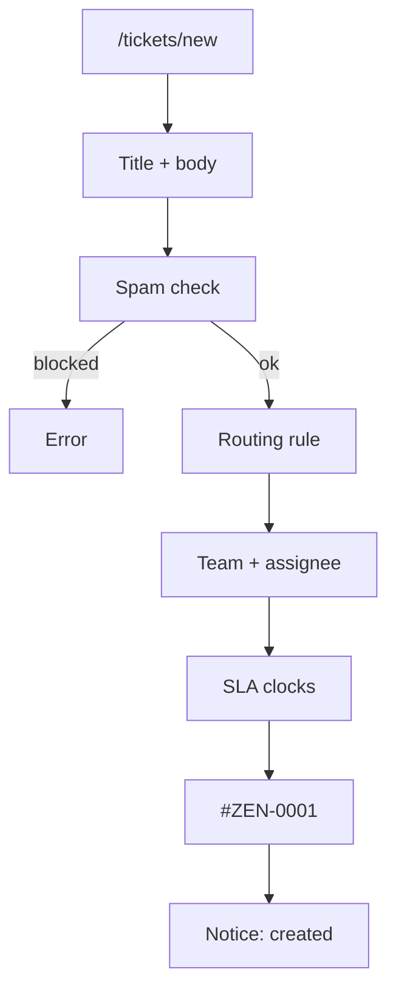
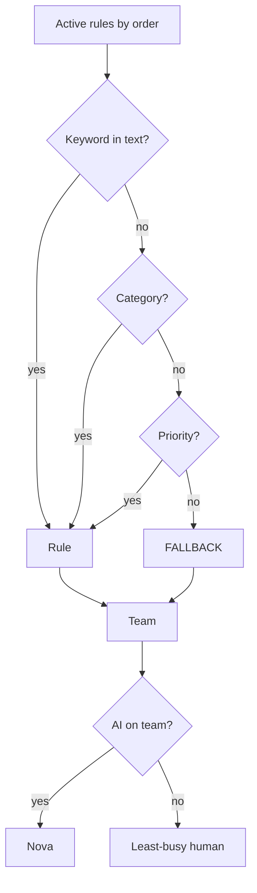

# Phase 2 — Tickets and routing

**Status:** complete on `main`.  
**Who it is for:** customers who file work; agents who receive it.  
**What it unlocks:** a stable ticket number, a team, an assignee, and two SLA clocks.

## Intro

A support desk is useless if staff cannot find a case. Phase 2 is the ticket engine. A customer opens `/tickets/new`, types a title and body, and the API mints **`#ZEN-XXXX`** (at least four digits, padded — `#ZEN-0001`, `#ZEN-1042`). The same call picks a **team**, an **assignee**, and **due times** for first response and resolution.

Help Center articles are **markdown files in this repo** (`apps/backend/kb/`), seeded into MySQL. There is no paid crawler and no Firecrawl. Related-article search on the create screen waits for **four characters** before it calls GraphQL (that wait is locked in Phase 9; the articles themselves belong here).

## Why this phase exists

Without a number, a team, and a clock, Phase 3 has nothing to show on the desk and Phase 4 has nothing to sweep. Routing is **rule-based**, not a neural net: keyword in the text, else category, else priority, else a fallback rule. If the matched team has an AI member, **Nova** is assigned first (Nova’s reply is Phase 7). Otherwise the least-busy human agent or supervisor on that team gets the ticket.

## What you see

| Screen | Who | What happens |
|--------|-----|----------------|
| `/tickets/new` | Customer+ | Form: title, body, type, optional category |
| `/tickets` | Customer+ | Own ticket list |
| `/tickets/[id]` | Customer (own) or staff | The case |
| `/queue` | Agent+ | Team work (Phase 3 paints the live desk) |
| `/knowledge` | Customer+ | Published Help Center |

Ticket types include question / incident-style values from the GraphQL input. Priority defaults to the category’s default, then a routing rule may override it.

## How create works

1. Must be signed in. Zod parses the input. Title and body are sanitised.
2. Quota and cooldown run for `CREATE_TICKET`.
3. Spam scoring. A block score returns an error; a flag still saves the ticket as flagged.
4. Active routing rules are loaded in `order`. First match wins: **KEYWORD** in title+body, else **CATEGORY**, else **PRIORITY**, else **FALLBACK**.
5. Team: from the rule, else the default team, else the first team. If none exist, create fails.
6. Assignee: AI teammate on that team if active; else least-busy `AGENT` / `SUPERVISOR`.
7. SLA due dates from the (possibly overridden) priority. Ticket number from the sequence.
8. Row is saved. Status is `OPEN` if assigned, else `NEW`. First message is the description.
9. Customer gets a “created” notice. Assignee gets “assigned” if it is not the customer.
10. Audit log. `ticketCreated` is published. `scheduleAiConsult` runs if Nova is the assignee.

## Routing in one picture

## Examples

- Body contains “VPN”. A KEYWORD rule for vpn points at the network team. Nova is on that team, so Nova is assigned.
- No rule matches. FALLBACK (or the default team) still creates a valid `#ZEN-…` ticket. Work is never dropped on the floor.
- Customer tries to open someone else’s id. Data scope from Phase 1 returns forbidden.

## Not in this phase

Live WebSocket thread (Phase 3), SLA sweep / CSAT (Phase 4), Nova’s written answer (Phase 7).

## Code

`apps/backend/src/services/ticket.service.ts` · `routingMatch.ts` · `routing.service.ts` · `utils/ticketNumber.ts` · `apps/backend/kb/`

[All phases](README.md) · [HTML gallery](index.html#p2)
