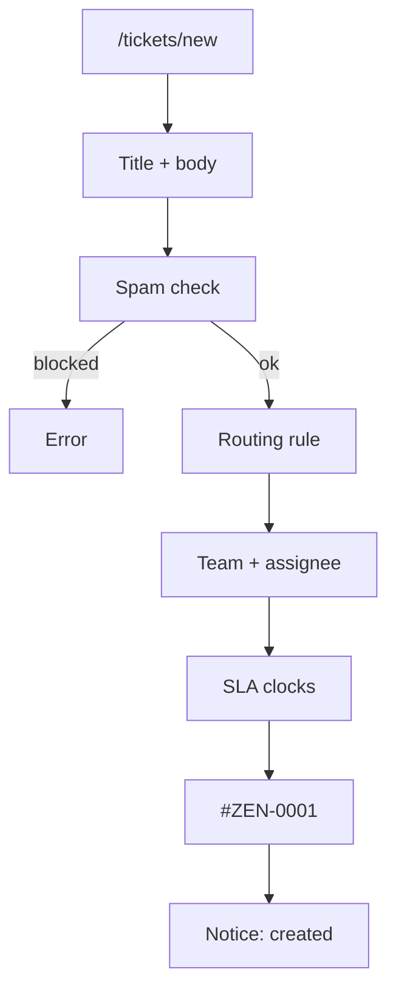
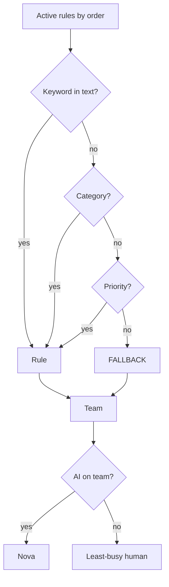

# Phase 2 — Tickets, routing, Help Center

**Status:** complete on `main`.

## Why this phase exists

Staff cannot work a queue without a stable ticket id, a team, and a clock. This slice mints `#ZEN-XXXX` (at least four digits), routes by keyword then category then priority then fallback, and keeps Help Center articles as markdown in the repo so the demo does not depend on a paid crawler.

## What was delivered

- Create path: Zod → quota/cooldown → spam → routing → SLA due dates → row → bell → audit → schedule Nova if Nova is on the team.
- Assignee: AI teammate first, else least-busy `AGENT` / `SUPERVISOR` on that team.
- Seeded articles in `apps/backend/kb/`.

## Customer journey

## Routing algorithm

## Use cases

- Body contains “VPN” → keyword rule → network team.
- No rule → default team; the ticket still exists.

## Code

`ticket.service.ts` · `routingMatch.ts` · `routing.service.ts` · `utils/ticketNumber.ts`

[All phases](README.md) · [HTML card](index.html#p2)
