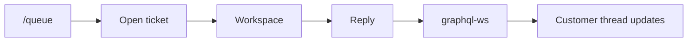
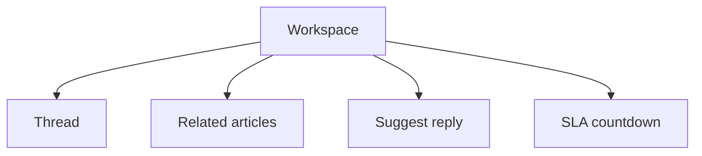

# Phase 3 — Live workspace

**Status:** complete on `main`.  
**Who it is for:** agents and supervisors working a ticket; customers watching the thread.  
**What it unlocks:** one open case, live messages, related Help Center, a suggested reply, an SLA countdown.

## Intro

Phase 2 created the ticket. Phase 3 is the **desk**. Staff open a case from `/queue` and stay on a **three-column workspace**: the thread in the middle, related articles and tools on the side. New messages do not need a refresh. They arrive over **GraphQL WebSockets** (`graphql-ws`). This demo does **not** use Socket.io.

The customer sees the same thread on `/tickets/[id]`. Internal notes stay off the customer view. Suggest-reply and related articles are for staff so they do not hunt the whole Help Center by hand.

## Why this phase exists

Reloading the page to see a reply is slow and easy to miss. A live subscription (`messageAdded`, plus `ticketUpdated` and `ticketCreated` on the queue) keeps everyone on the same case. Related articles are ranked by **keyword overlap and category**, not by a paid search API. Suggest-reply uses a **category template** and may include a Help Center snippet.

## What you see

| Pane | Contents |
|------|----------|
| Thread | Customer and staff messages, Nova replies, system events (“Nova is checking…”) |
| Related | Published articles closest to this ticket |
| Suggest reply | Canned text the agent can paste and edit |
| SLA | Countdown: overdue, hours left, or days left |

Queue is `/queue` (Agent+). Supervisor watch is `/supervisor`. Mobile stacks the columns so the page does not scroll sideways (Phase 9 polish).

## How a reply moves

1. Agent opens the ticket from the queue.
2. Workspace loads the thread and subscribes to `messageAdded(ticketId)`.
3. Agent types a reply (or uses suggest-reply). Mutation saves the message.
4. The server publishes on the ticket’s topic. Every open workspace for that id paints the new line.
5. Customer receives an in-app notice (Phase 8 bell) if they are not staring at the page.

## Desk layout

## Examples

- Two agents have the same ticket open. One replies. The other sees the line without refresh.
- Related pane lists VPN articles when the ticket is in that category.
- SLA chip turns to “overdue” when the response clock from Phase 2 has passed (the **sweep** that flags breach is Phase 4).

## Not in this phase

Nova’s first automatic answer (Phase 7). Admin screens for routing rules (Phase 4). Attachments (Phase 8).

## Code

`apps/frontend/src/modules/tickets/components/TicketWorkspace.tsx` · `relatedRank` · `suggestReply` · graphql-ws on the API

[All phases](README.md) · [HTML gallery](index.html#p3)
