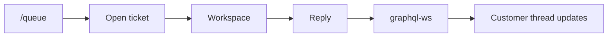
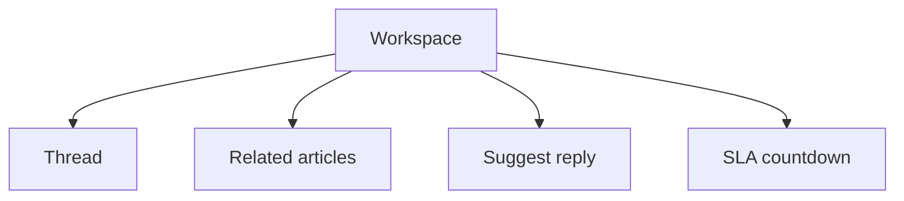

# Phase 3 — Live workspace

**Status:** complete on `main`.

## Why this phase exists

Reloading the page to see a reply wastes time. This slice keeps one ticket on a three-column desk and pushes new messages with GraphQL WebSockets (`graphql-ws`, not Socket.io). Related articles and a suggested reply sit next to the thread so an agent does not search the whole Help Center by hand.

## What was delivered

- Subscriptions: `messageAdded`, `ticketUpdated`, `ticketCreated`.
- Related articles ranked by keyword + category.
- Suggest-reply from category templates plus a Help Center snippet.
- SLA countdown: overdue, hours, or days.

## Agent journey

## Desk layout

## Use cases

- Two staff watch the same ticket; a new message appears without refresh.
- Related pane lists the closest published articles for that category.

## Code

`TicketWorkspace.tsx` · `relatedRank` · `suggestReply` · graphql-ws server

[All phases](README.md) · [HTML card](index.html#p3)
