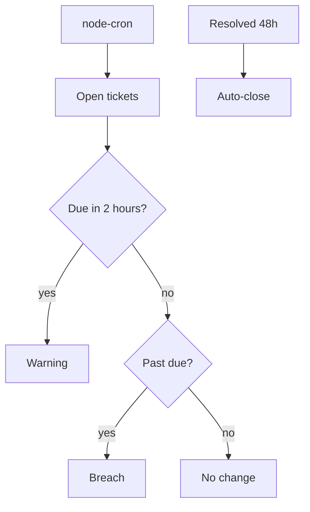
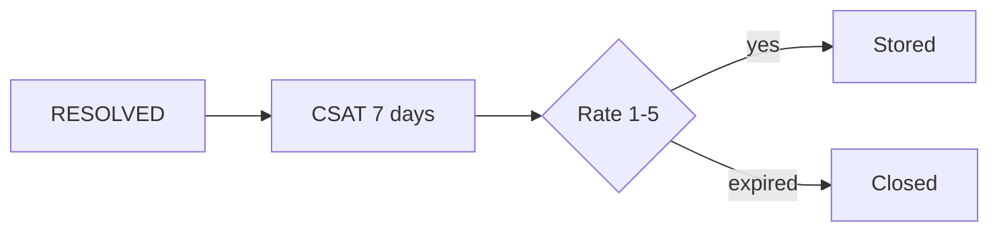

# Phase 4 — SLA, CSAT, and admin

**Status:** complete on `main`.  
**Who it is for:** supervisors watching promises; admins who edit users, teams, routing, and SLA; customers who rate a resolved ticket.  
**What it unlocks:** a clock job, a short survey, and admin screens so nobody edits MySQL by hand.

## Intro

Phase 2 stamped **response** and **resolution** due times on the ticket. Phase 4 is the **clock that walks those tickets**. A `node-cron` job (default every **two minutes**) marks warning, breach, and auto-close. When an agent sets status to **RESOLVED**, a **CSAT** window opens for **seven days**. The customer rates **1–5**. A value outside that range is clamped (9 becomes 5).

Admins configure the desk in the UI: users, teams, routing rules, SLA policies, and knowledge. Supervisors can open routing. Customers cannot.

## Why this phase exists

A desk that never warns on late work will miss the promise printed on the ticket. Spreadsheets do not beep. This job is small on purpose: warning if due within **2 hours**, breach if past due, auto-close **48 hours** after resolve. Cron can be disabled with `DISABLE_CRON=1` (useful in tests).

Rule-based Help Center Q&A also belongs here: if the score is too low the answer is “I do not know”, and sources are still listed. Nova’s fuller consult is Phase 7.

## What you see

| Screen | Who | Purpose |
|--------|-----|---------|
| `/admin/users` | Admin+ | Accounts, roles, ban |
| `/admin/teams` | Admin+ | Teams and members |
| `/admin/routing` | Supervisor+ | Keyword / category / priority / fallback rules |
| `/admin/sla` | Admin+ | Hours by priority |
| `/admin/knowledge` | Admin+ | Publish drafts |
| Ticket after resolve | Customer | CSAT prompt for 7 days |

## How the SLA sweep works

1. Cron fires (`SLA_CHECK_INTERVAL_CRON` or `*/2 * * * *`).
2. Open tickets are loaded.
3. If resolution (or response) due is within 2 hours → **warning**.
4. If due time is already past → **breach**.
5. If status has been RESOLVED for 48 hours → **auto-close**.
6. Notices can fire for SLA events (Phase 8 bell).

## How CSAT works

1. Staff set status to RESOLVED.
2. A CSAT row opens, expiry = now + 7 days.
3. Customer submits 1–5. Stored.
4. After expiry, the window will not accept a late score.

## Examples

- Supervisor sees a ticket in warning an hour before breach.
- Customer types 9. Stored as 5.
- `DISABLE_CRON=1` during a local test so the sweep does not close tickets mid-demo.

## Not in this phase

Analytics charts (Phase 6). Nova wording (Phase 7). Consultant 90-day packs (Phase 6 / 9).

## Code

`apps/backend/src/jobs/slaCron.ts` · `slaSweep.ts` · `csatRules.ts` · `apps/frontend/src/app/(admin)/`

[All phases](README.md) · [HTML gallery](index.html#p4)
