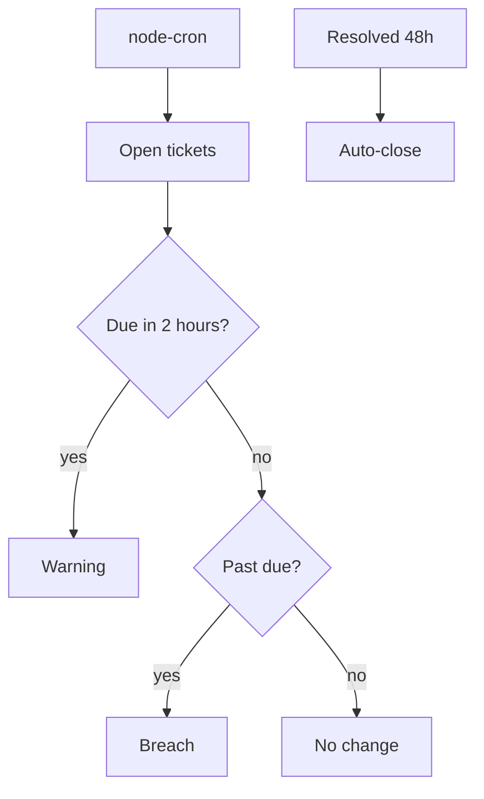
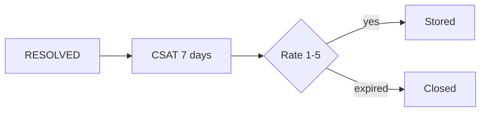

# Phase 4 — SLA, CSAT, admin

**Status:** complete on `main`.

## Why this phase exists

A desk that never warns on late work will miss the promise printed on the ticket. A small clock job walks open tickets. When work is resolved, the customer gets a short survey. Admins change users, teams, routing, and SLA on screen instead of editing the database by hand.

## What was delivered

- Cron every 2 minutes (`*/2 * * * *`), off when `DISABLE_CRON=1`.
- Warning if due within **2 hours**. Breach if past due. Auto-close **48 hours** after resolve.
- CSAT open **7 days**, rating clamped **1–5**.
- Admin: users, teams, routing, SLA, knowledge.

## SLA algorithm

## CSAT journey

## Use cases

- Supervisor sees warning before breach.
- A rating of 9 is stored as 5.

## Code

`jobs/slaCron.ts` · `slaSweep.ts` · `csatRules.ts` · `app/(admin)/`

[All phases](README.md) · [HTML card](index.html#p4)
