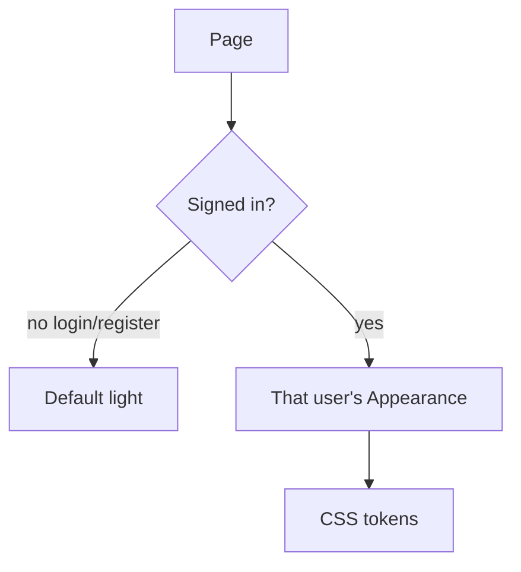
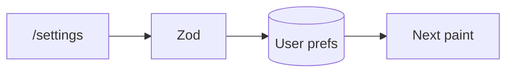

# Phase 5 — Appearance

**Status:** complete on `main`.

## Why this phase exists

One shared dark mode on a demo laptop means the next person inherits yesterday’s theme. Appearance belongs to the signed-in user. Login and register stay on the default light theme so a public page never loads leftover tokens.

## What was delivered

- `/settings` for every signed-in role.
- Hex, contrast, and font tokens validated on UI and API.
- Ticket list views stored with that user.

## Who sees which theme

## Save path

## Use cases

- Admin chooses dark. A customer on the same browser still sees light until that customer signs in.

## Code

`lib/appearance.ts` · `appearanceTokens.ts` · `app/settings`

[All phases](README.md) · [HTML card](index.html#p5)
