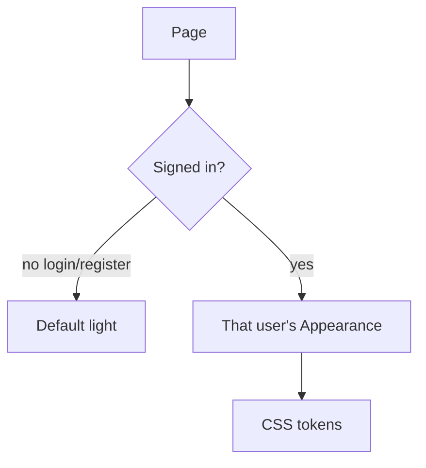
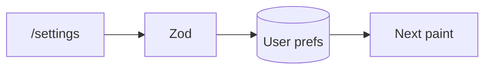

# Phase 5 — Appearance

**Status:** complete on `main`.  
**Who it is for:** any signed-in person who wants their own light/dark tokens.  
**What it unlocks:** `/settings` theme that belongs to **that user**, not the whole laptop.

## Intro

Appearance is **per account**, not per browser and not “company dark mode”. An admin can sit on a demo machine, choose a dark palette, and log out. The next person who opens `/login` still sees the **default light** public theme. Only after **that** person signs in do their saved tokens apply.

This exists because a shared dark mode on one laptop made the following demo user inherit yesterday’s colours. Login, register, and forgot-password stay light on purpose so a public page never loads leftover `theme` keys from `localStorage`.

## Why this phase exists

Managers sharing a laptop should not fight over the UI. Tokens (hex colours, contrast, font stack) are validated on **both** the Next app and the API (Zod / appearance helpers). Invalid hex is rejected. Ticket **list views** (filters the user prefers) are stored with the same user record.

## What you see

| Screen | Theme |
|--------|--------|
| `/login` `/register` `/forgot-password` | Always default light |
| `/settings` | Editor for the signed-in user |
| All signed-in app pages | That user’s saved Appearance |

Settings is available to every role that can sign in. Customers get the same Appearance page; they do not get admin consoles.

## How theme is chosen

1. Request a page.
2. If the route is public auth → force light, clear leftover theme keys.
3. If signed in → load that user’s Appearance from the API / cache.
4. Apply CSS variables (colours, contrast, font).

## How a save works

1. User edits `/settings` and saves.
2. Client and server validate tokens (hex, contrast, font).
3. Prefs are stored on the user row.
4. The next paint of signed-in pages uses the new tokens. Public pages still ignore them.

## Examples

- Admin sets dark slate. Logs out. Customer logs in on the same Chrome profile. Customer sees **light** until they themselves pick a theme.
- A broken hex in a crafted request is rejected; the previous valid theme stays.

## Not in this phase

PWA mobile chrome and login splash (Phase 9). Chart colours on analytics (Phase 6 uses Recharts; they follow the page theme where wired).

## Code

`apps/frontend/src/lib/appearance.ts` · `appearanceCore.ts` · `apps/backend/src/services/appearanceTokens.ts` · `apps/frontend/src/app/settings`

[All phases](README.md) · [HTML gallery](index.html#p5)
