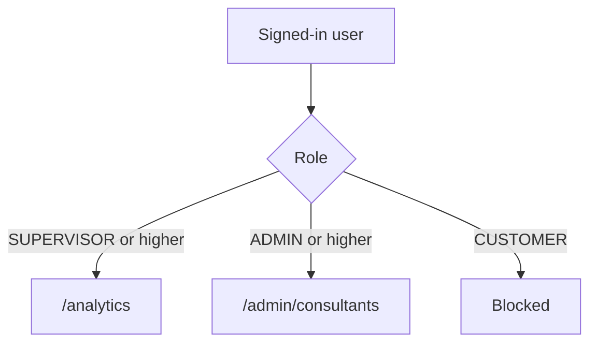
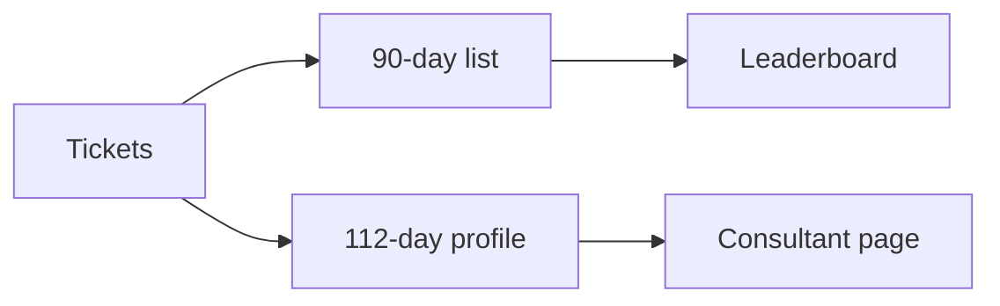

# Phase 6 — Analytics and consultants

**Status:** complete on `main`.

## Why this phase exists

Supervisors need volume and CSAT without a spreadsheet export. Admins need a consultant board. Full history on every click was too slow, so lists use a **90-day** ticket pack and profiles use **112 days**.

## What was delivered

- `/analytics` — Supervisor and above.
- `/admin/consultants` — Admin and above.
- Leaderboard ties: stable sort (`localeCompare`, then id).
- Client `filterByQuery` searches the loaded pack only.

## Access

## Data window

## Use cases

- Supervisor opens analytics; a customer cannot.
- Typing in consultants filters rows already on screen.

## Code

`analytics.service.ts` · `consultantPack.ts` · `lib/listSearch.ts`

[All phases](README.md) · [HTML card](index.html#p6)
