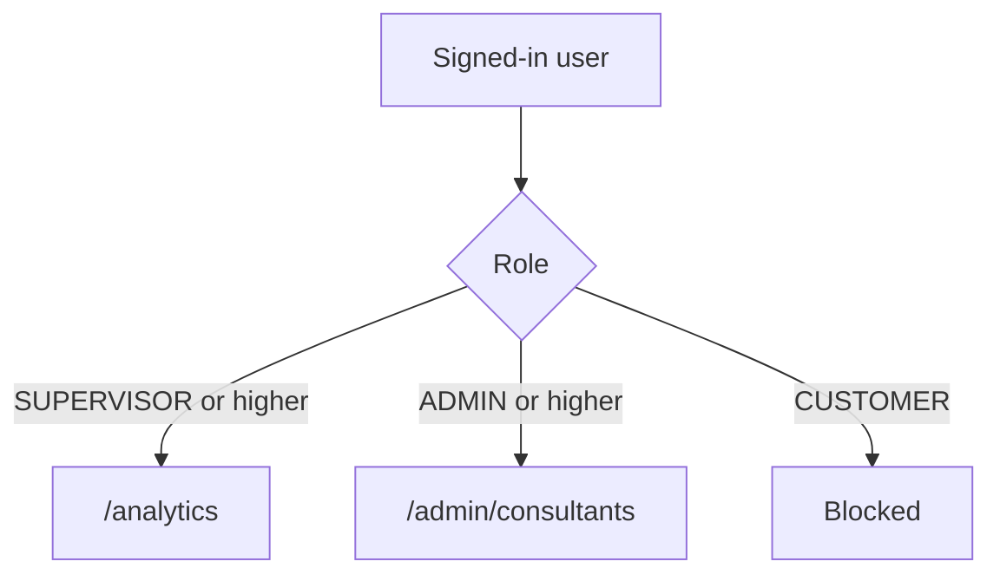
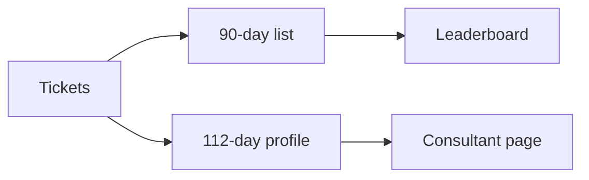

# Phase 6 — Analytics and consultants

**Status:** complete on `main`.  
**Who it is for:** supervisors (volume and CSAT) and admins (consultant board).  
**What it unlocks:** `/analytics` and `/admin/consultants` without scanning lifetime ticket history on every click.

## Intro

Supervisors need “how busy were we?” without exporting a spreadsheet. Admins need a consultant list with solved / CSAT style KPIs. Loading **every ticket ever** made those tabs slow. Phase 6 (and the Phase 9 pack) therefore uses a **time window**:

- **Analytics** charts typically ask for a **30-day** range.
- **Consultant list** KPIs use assigned tickets from the last **90 days**.
- **Consultant profile** uses **112 days**.

A customer who opens `/analytics` is blocked. An agent is not a supervisor; they do not get this home. Typing in the consultants search box filters the **already loaded pack** in the browser (`filterByQuery`). It does not fire GraphQL for every letter.

## Why this phase exists

A demo laptop and a growing seed (144 tickets in the last e2e run) cannot rescan the whole table on each admin tab. Packs keep the page honest: numbers are “recent work”, not lifetime fame. Leaderboard ties use a **stable sort** (`localeCompare`, then id) so refresh does not shuffle equal scores.

## What you see

| Screen | Who | Contents |
|--------|-----|----------|
| `/analytics` | Supervisor+ | Volume, CSAT-style charts (Recharts, lazy) |
| `/admin/consultants` | Admin+ | List + search on the 90-day pack |
| `/admin/consultants/[id]` | Admin+ | Profile, 112-day pack |

## How access works

1. Role is read from the signed-in user (Phase 1).
2. Supervisor or higher → `/analytics` allowed.
3. Admin or higher → consultants allowed.
4. Customer → forbidden.

## How the data window works

Tickets in MySQL stay forever. **Queries** for these screens cut by `createdAt` / assignment date using `ticketPackSince(days)`.

## Examples

- Supervisor opens analytics. Charts fill after a short skeleton (Phase 9). A customer bookmarking the same URL is bounced.
- Admin types “sla” in consultants. Only rows already on screen that match the substring remain. `admin` will also match `SUPER_ADMIN` because search is a simple substring.

## Not in this phase

Email exports, paid BI, lifetime KPIs. Nova quality metrics beyond what the pack already exposes.

## Code

`apps/backend/src/services/analytics.service.ts` · `consultantPack.ts` · `apps/frontend/src/lib/listSearch.ts` · `apps/frontend/src/app/(admin)/analytics`

[All phases](README.md) · [HTML gallery](index.html#p6)
