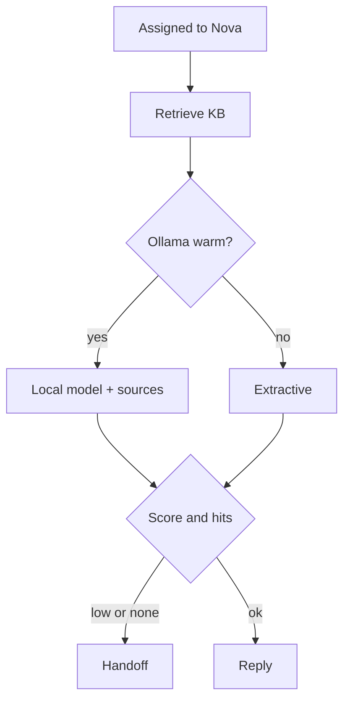
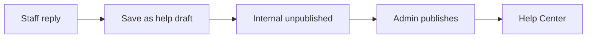

# Phase 7 — Nova

**Status:** complete on `main`.

## Why this phase exists

First reply should not wait on a person if the Help Center already has the answer. Nova is a seeded AI user. It only reads owned markdown. A local Ollama process is optional. There is no paid cloud LLM. If confidence is below **0.45** or there are zero hits, the ticket goes to a human. Staff can save a reply as an internal unpublished draft. Only an admin publishes it.

## What was delivered

- Retrieve `apps/backend/kb/` → Ollama if warm → else extractive text.
- Handoff on low confidence, zero hits, or “Still need a person”.
- `buildKbDraftFromTicket` uses a staff (non-AI) reply; never auto-public.

## First-reply algorithm

## Draft to Help Center

## Use cases

- Ollama not installed → ticket still gets a KB extract.
- Draft stays hidden from customers until publish.

## Code

`consultTicket.service.ts` · `consultMath.ts` · `kbDraft.ts` · `kbPack.ts`

[All phases](README.md) · [HTML card](index.html#p7)
