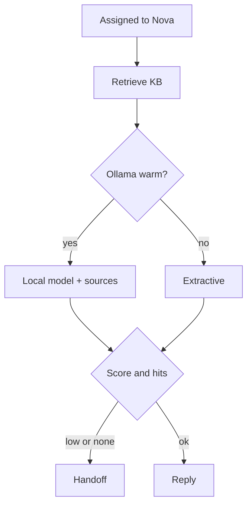
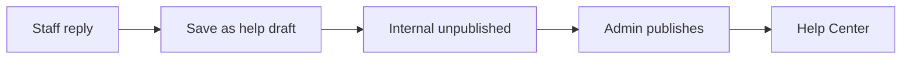

# Phase 7 — Nova

**Status:** complete on `main`.  
**Who it is for:** customers waiting on a first reply; staff who hand off or save a Help Center draft.  
**What it unlocks:** an AI user that answers **only** from owned Help Center markdown, with a human backup.

## Intro

Nova is a **seeded user** (`nova@zenflowai.com`, flagged `isAiConsultant`). When routing (Phase 2) puts Nova on the ticket, the API schedules a consult. Nova does **not** call paid OpenAI. It retrieves published articles from `apps/backend/kb/` (and the DB copy). If a **local Ollama** process is healthy, Nova writes a grounded answer from those sources. If Ollama is down or cold, Nova **extracts** from the articles instead. The customer still gets a reply.

If confidence is below **0.45**, or there are **zero** hits, or the customer clicks **“Still need a person”**, the ticket is handed to the least-busy human on the team. Staff may press **Save as help draft**. That creates an **internal unpublished** article from a **staff (non-AI) reply**. Only an admin publishes it. Nothing goes public by itself.

## Why this phase exists

First reply should not wait on a human if the team already wrote the answer. A cloud LLM would need keys, money, and data leaving the laptop. This demo is local: owned markdown first, optional Ollama, extractive fallback, human handoff. Drafts need an editor so a raw ticket thread cannot leak onto the Help Center.

## What you see

| Moment | What the thread shows |
|--------|------------------------|
| Consult starts | System line: Nova is checking the knowledge base |
| Good match | Reply + sources + “Nova (local model + KB)” or “Nova (knowledge base)” |
| Weak match | Handoff message; a person is assigned |
| Staff draft | Button on the workspace; admin later publishes in `/admin/knowledge` |

`pnpm --filter backend ai:doctor` prints whether the engine is Ollama or retrieval.

## How first reply works

1. Ticket `assignedToId` is Nova.
2. Nova posts a system event, then `consult()` on title + description.
3. Retrieve KB chunks. If Ollama is warm (probe circuit: three failures cool it down), generate with a “answer only from sources” prompt. Else extractive text.
4. Confidence from the retrieval score. `shouldHandoff` if hits = 0 or confidence is below `0.45`.
5. Handoff: pick least-busy human, notify, stop. Else post the formatted reply, set first-responded, status `IN_PROGRESS`.

## How a draft reaches the Help Center

1. A **human** staff reply exists (AI-only replies are not used if a human line is there).
2. Save as help draft → title like `#ZEN-1042: …`, body = question + resolution + “Internal until an admin publishes.”
3. Admin opens `/admin/knowledge` and publishes.
4. Customers see it on `/knowledge`. Nova may retrieve it on later tickets.

## Examples

- Ollama is not installed. Ticket still gets a KB extract. `ai:doctor` says retrieval.
- Customer clicks “Still need a person”. Handoff even if the score was high.
- Agent saves a draft. Customer Help Center does not show it until an admin publishes.

## Not in this phase

Paid OpenAI, embeddings SaaS, auto-publish, emailing the customer the AI reply.

## Code

`consultTicket.service.ts` · `consult.service.ts` · `consultMath.ts` (`HANDOFF_THRESHOLD = 0.45`) · `kbDraft.ts` · `kbPack.ts` · `ollamaProbe.ts`

[All phases](README.md) · [HTML gallery](index.html#p7)
