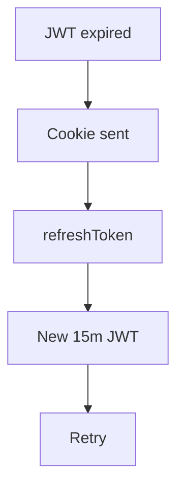
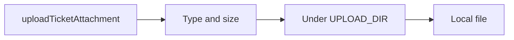

# Phase 8 — Cookie, migrations, files, bell

**Status:** complete on `main`.

## Why this phase exists

Demo databases that were only “pushed” once drifted from the schema. Refresh tokens in frontend storage were easy to copy. This slice commits Prisma migrations, stores the refresh token in an HttpOnly cookie, writes attachments to a local folder (gitignored), and shows in-app notices for create, assign, reply, and SLA.

## What was delivered

- Cookie `zenflow_refresh`. `Secure` only when `NODE_ENV=production`.
- Upload path jail, size cap, no `..` traversal.
- Public GraphQL errors do not include Prisma schema text.

## Session refresh

## Attachment

## Use cases

- Old demo DB: `prisma migrate resolve --applied 20260922150000_init` once, then migrate.
- Customer sees a bell when Nova or an agent replies.

## Code

`refreshCookie.ts` · `uploadPath.ts` · `notify.service.ts` · `prisma/migrations`

[All phases](README.md) · [HTML card](index.html#p8)
