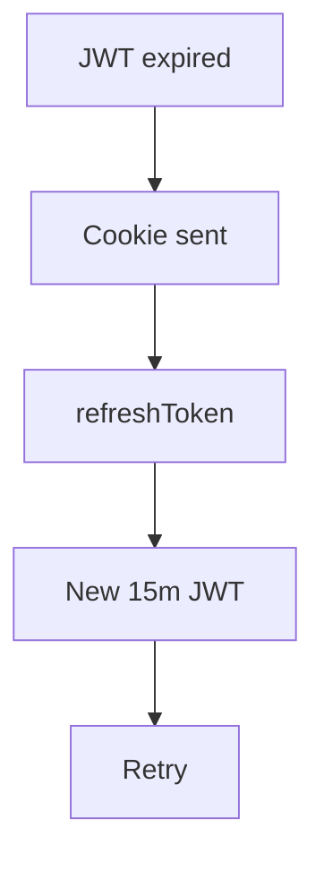
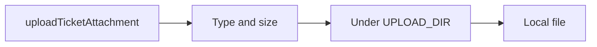

# Phase 8 — Hardening (cookie, migrations, files, bell)

**Status:** complete on `main`.  
**Who it is for:** anyone running the demo more than once; customers who attach a screenshot or watch the bell.  
**What it unlocks:** a durable database, a steal-resistant refresh token, local file uploads, in-app notices.

## Intro

Early demos used `prisma db push` and kept refresh tokens where JavaScript could read them. Databases drifted. Tokens were easy to copy. Phase 8 hardens the local MVP without adding cloud services.

- **Migrations** are committed. Clone → `db:generate` → `db:migrate` → `db:seed`.
- **Refresh** lives in cookie `zenflow_refresh` (HttpOnly, Path=/, SameSite=Lax). `Secure` only when `NODE_ENV=production`.
- **Attachments** go to `UPLOAD_DIR` (default `./uploads`, gitignored). Paths cannot walk `..` out of that folder. Size is capped.
- **Bell:** create, assign, reply, and SLA write `Notification` rows. `myNotifications` is the GraphQL list.

Public GraphQL errors **do not** dump Prisma schema text if the database is out of date.

## Why this phase exists

A manager cloning the repo should get the same schema as CI, not a laptop that was pushed once in June. Putting the refresh token in an HttpOnly cookie matches the original auth plan (Phase 1 cookie, Phase 8 wiring). Local disk is enough for a demo; there is no S3.

## What you see

| Feature | Where |
|---------|--------|
| Refresh after 15m | Silent; no extra login if the cookie is valid |
| Attachment | Mutation `uploadTicketAttachment` on a ticket the person may open |
| Bell | Header notices; `query { myNotifications { … } }` |
| Old demo DB | One-time `prisma migrate resolve --applied 20260922150000_init` |

## How session refresh works

1. Access JWT expires (15 minutes).
2. Apollo retries with credentials. Browser sends `zenflow_refresh`.
3. `refreshToken` mutation rotates access JWT.
4. Original GraphQL call retries.

## How an attachment is stored

1. Client sends filename, MIME, base64 (or equivalent) and `ticketId`.
2. Auth + permission: must see that ticket.
3. MIME and size checks. Path is joined under `UPLOAD_DIR` only — no `../etc/passwd`.
4. File is written locally. Metadata is stored on the ticket.

## Examples

- Clone on a new machine: migrate + seed. Ticket numbers and users match the README logins.
- Old database from `db push`: resolve the init migration once, then migrate again.
- Customer gets a bell when Nova or an agent replies, even if the workspace tab is closed.

## Not in this phase

S3/R2, CDN, email for notices, virus scanning. Path jail is the file security story.

## Code

`refreshCookie.ts` · `uploadPath.ts` · `notify.service.ts` · `publicGraphqlError.ts` · `apps/backend/prisma/migrations`

[All phases](README.md) · [HTML gallery](index.html#p8)
