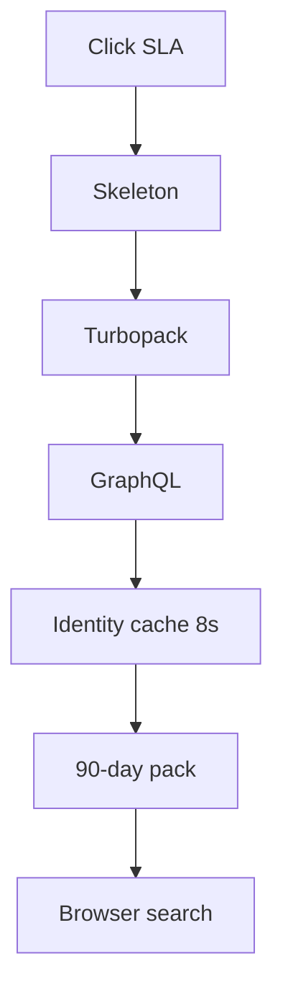
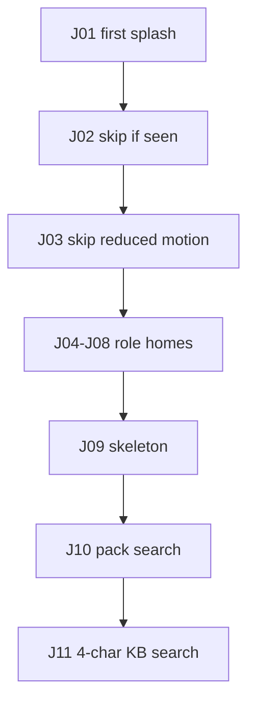

# Phase 9 — UI, speed, and QA

**Status:** complete on `main`.  
**Who it is for:** anyone clicking admin tabs on a laptop; anyone who needs a test sheet without reading a terminal.  
**What it unlocks:** faster paint of the **same** screens, plus 140 unit tests and HTML reports.

## Intro

Phase 9 does **not** add a tenth role or a new product area. Admin tabs felt empty because Next.js compiled each `'use client'` page on demand, then GraphQL auth hit MySQL twice. The SLA **form** was not the bottleneck.

This slice paints sooner:

- **Turbopack** in `pnpm dev` (production `next build` is unchanged).
- **`loading.tsx` skeletons** on admin, agent, customer, and settings groups — not an empty pane.
- **8-second** auth identity cache (Phase 1 row, used here so tabs do not double-query).
- **90 / 112 day** consultant packs (Phase 6 windows, used here so lists stay small).
- **`filterByQuery`** in the browser for those packs.
- **PWA chrome** at 1024px and below. Login **splash** (three scenes, key `zenflow-auth-splash-v5`) plays once; skipped if already seen or if reduced motion is on.

QA: **140** Prisma-free unit tests, **100% c8 lines** on that pack. Live `pnpm test:e2e` when GraphQL is up. HTML bars at `/qa/v1`. Journey and algorithm pictures at `/qa/phases`.

## Why this phase exists

A demo that stutters on Users → Teams → SLA looks unfinished even when the math is correct. Tests that only exist in a terminal are invisible to a manager. This phase makes both visible.

## What you see

| Change | Where it shows |
|--------|----------------|
| Skeleton then content | `/admin/sla`, `/admin/users`, `/queue`, `/tickets`, `/settings`, … |
| Splash once | First visit to login |
| Pack search | Admin lists (consultants, users, …) |
| Test bars | [http://localhost:3000/qa/v1](http://localhost:3000/qa/v1/) |
| Phase charts | [http://localhost:3000/qa/phases](http://localhost:3000/qa/phases) |

Create-ticket Help Center search still waits for **4 characters** before GraphQL. That is deliberate so typing “vpn” does not fire on the first letter.

## How an admin tab feels after this phase

1. Click SLA in the sidebar.
2. `loading.tsx` shows a skeleton immediately.
3. Turbopack serves the page module.
4. GraphQL runs. JWT is verified; user + permissions may be an 8s cache hit.
5. Pack of rows arrives. Search filters in the browser.

## Journeys the unit pack locks (J01–J11)

| Id | Story |
|----|--------|
| J01 | First visit shows splash |
| J02 | Returning visit skips splash |
| J03 | Reduced motion never plays splash |
| J04–J08 | Each role’s home is a path that role may open |
| J09 | Signed-in groups ship a skeleton, not an empty pane |
| J10 | List search filters the loaded pack only |
| J11 | New ticket waits 4 characters before Help Center GraphQL |

## Examples

- First login: splash, then form. Second login the same day: form only.
- Ban an account: up to 8 seconds of cache, then blocked (same number as Phase 1).
- `pnpm test` is 140/140 without MySQL. `pnpm test:e2e` needs the API.

## Not in this phase

New roles, email, hosting, 100% coverage of every Next page and Prisma service (those stay out of CI LCOV on purpose).

## Code

`lib/splash.ts` · `lib/listSearch.ts` · `lib/uiPerf.ts` · `lib/journeys.test.ts` · `authContextCache.ts` · `public/qa/v1` · `docs/phases/`

[All phases](README.md) · [HTML gallery](index.html#p9) · [Test bars](../test-results/v1/index.html)
