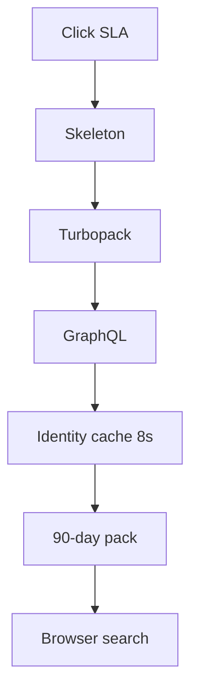
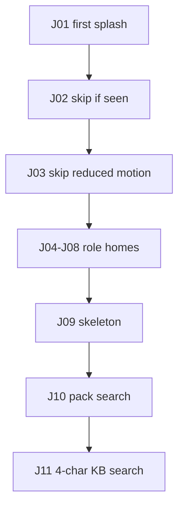

# Phase 9 — UI, speed, QA

**Status:** complete on `main`.

## Why this phase exists

Admin tabs felt empty while Next.js compiled each client page, then auth hit MySQL twice. This slice does not add roles. It paints the same screens sooner and publishes a phase-by-phase test sheet so results are visible without a terminal.

## What was delivered

- `next dev --turbopack`, `loading.tsx` skeletons, CSS route fade, 8-second auth identity cache, 90-day consultant packs, `filterByQuery`.
- PWA chrome at **1024px** and below. Splash: three scenes, skip if seen or reduced motion (`zenflow-auth-splash-v5`).
- **140** Prisma-free unit tests, **100%** c8 lines on that pack. Live e2e when GraphQL is up.
- Report: `/qa/v1`. Journeys J01–J11 in `journeys.test.ts`.

## Admin tab after this phase

## Journeys

## Use cases

- First login shows splash once.
- Create-ticket related articles still query GraphQL after **4** characters.

## Code

`lib/splash.ts` · `lib/listSearch.ts` · `lib/uiPerf.ts` · `lib/journeys.test.ts` · `public/qa/v1`

[All phases](README.md) · [HTML card](index.html#p9) · [Test bars](../test-results/v1/index.html)
