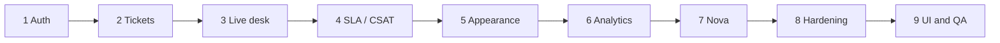

# Phases 1–9 (complete)

These folders replaced the old in-`PLAN.md` charts. Each phase has a short Markdown story (GitHub draws the diagrams) and the same charts in one HTML gallery.

| Open | Where |
|------|--------|
| Colorful gallery | [index.html](index.html) · with the app: [http://localhost:3000/qa/phases](http://localhost:3000/qa/phases) |
| Test bars | [../test-results/v1/index.html](../test-results/v1/index.html) · [http://localhost:3000/qa/v1](http://localhost:3000/qa/v1) |
| Architecture notes | [../../PLAN.md](../../PLAN.md) |

| Phase | Title | Markdown | HTML |
|------:|-------|----------|------|
| 1 | Auth and security | [01-auth.md](01-auth.md) | [index.html#p1](index.html#p1) |
| 2 | Tickets, routing, Help Center | [02-tickets.md](02-tickets.md) | [index.html#p2](index.html#p2) |
| 3 | Live workspace | [03-workspace.md](03-workspace.md) | [index.html#p3](index.html#p3) |
| 4 | SLA, CSAT, admin | [04-sla-csat.md](04-sla-csat.md) | [index.html#p4](index.html#p4) |
| 5 | Appearance | [05-appearance.md](05-appearance.md) | [index.html#p5](index.html#p5) |
| 6 | Analytics and consultants | [06-analytics.md](06-analytics.md) | [index.html#p6](index.html#p6) |
| 7 | Nova | [07-nova.md](07-nova.md) | [index.html#p7](index.html#p7) |
| 8 | Cookie, files, bell | [08-hardening.md](08-hardening.md) | [index.html#p8](index.html#p8) |
| 9 | UI, speed, QA | [09-ui-qa.md](09-ui-qa.md) | [index.html#p9](index.html#p9) |

Not in this demo: email, cloud object storage, Firecrawl, paid OpenAI, webhooks, SSO, hosted MySQL in CI.
